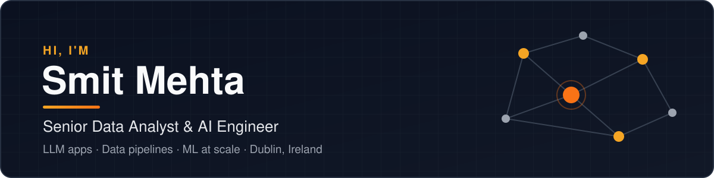

  

I build anything that makes my life easier.

<b>Stack:</b> Python · SQL · PySpark · Pandas · XGBoost · LangGraph · MCP · AWS EMR · JavaScript

## Live projects

| Project | What it does |
|---|---|
| [Game Night](https://game-night.visaupdates.workers.dev) | Party games for one room. Everyone plays on their phone while a tablet hosts: Mafia, Imposter, Fishbowl and more. |
| [FlightOverHead](https://flightoverhead.visaupdates.workers.dev) | See the planes flying over you right now, upcoming flyovers, and your own spotting collection. |
| [DumbPoker](https://pocketwise-club-table.pages.dev) | Beginner poker helper: hand rankings, your odds and what to do next. |
| [Dublin Visa Monitor](https://dublin-visa-monitor.visaupdates.workers.dev) | Live board of Schengen visa appointment slots in Dublin, with alerts when new dates open. |
| [Anti-doom](https://anti-doom.pages.dev) | A personal feed of posts from sites I choose, built to replace doom-scrolling. Sign-in required. |

**Demos of my pinned projects:** <a href="https://smitmehta19.github.io/SwissPDF/">SwissPDF</a> · <a href="https://smitmehta19.github.io/">Terminal Portfolio</a> · <a href="https://smitmehta19.github.io/home-workout-app/">Home Gym</a> · <a href="https://smitmehta19.github.io/fovea/">Fovea</a> · <a href="https://smitmehta19.github.io/cookflow/">CookFlow</a> · <a href="https://smitmehta19.github.io/pixrow-play/">PixRow</a>
